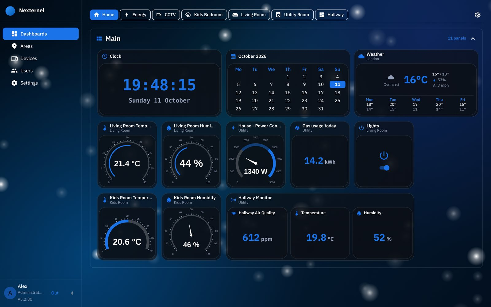

# Nexternel

**Your home, on your own server.** Nexternel brings your sensors, switches, cameras and energy
readings together on dashboards you arrange yourself. It runs on a small Linux machine in your
home and needs no cloud account: your data stays with you.



## What it does

- **Dashboards your way:** readings, switches, charts, gauges, cameras, weather, clock and calendar
  panels on as many dashboards as you like. The layout flows to fit a laptop, a phone or a wall tablet.
  Every panel can have its own title and icon.
- **Your devices:**
  - ESP32 boards running ESPHome, built and flashed from the browser
  - Shelly switches over MQTT
  - Octopus Energy for electricity and gas usage
- **Cameras** play live in the browser.
- **History:** every reading is kept for charts.
- **Users and roles** for everyone in the household.
- **Looks:** light or dark, your accent colour, soft-glow or gradient backgrounds, and calm
  background effects like snow, fireflies or aurora.
- **Backups that move a whole home:**
  - an encrypted backup every day, with an emergency key you keep somewhere safe
  - restoring on a new server brings back every device, dashboard, account and all history
  - devices reconnect by themselves
- **Installs with one command,** then asks whether to start fresh or restore a backup.

## Install

On a 64-bit Ubuntu, Debian or Raspberry Pi OS machine:

```bash
curl -fsSL https://www.reynsys.com/install.sh | bash
```

Then open the address it shows (`http://nexternel.local`, or for example `http://192.168.1.20`) and choose
**Start fresh** or **Restore from backup**.

The full guide covers what you need, giving the server a fixed address, moving to a new server,
updating, and backups: **[INSTALL.md](INSTALL.md)**.

## Update

```bash
cd ~/nexternel && ./scripts/update.sh
```

Your settings, backups and devices stay as they are. If an update fails, the previous version is put
back.

## Built with

ESPHome, Eclipse Mosquitto (MQTT), PostgreSQL, InfluxDB, go2rtc, React and Fastify, all running in
Docker. See [THIRD_PARTY.md](THIRD_PARTY.md).

## License

Nexternel is free software under the **GNU General Public License v3.0**. See [LICENSE](LICENSE) and
[COPYRIGHT.md](COPYRIGHT.md). Copyright © 2026 Rey Osman.

Found a security problem? Please read [SECURITY.md](SECURITY.md) before reporting it.
